# Nutri Agent

A diet assistant built around one idea: **the AI handles language, the code handles numbers.**

You create an account and describe yourself once (age, weight, height, activity, goal, diet, allergies). Then:

- **Food log:** write what you ate in your own words, e.g. *"2 slices of cheese pizza and a can of cola"*. An AI splits it into foods, and the nutrients come from the official **USDA FoodData Central** database.
- **Insights:** compares the last 7 days with **your official daily targets** (NIH Dietary Reference Intakes for your age and sex), shows what you are missing, and explains it: *"you ate mostly pizza and cola, so vitamin C is low; red bell pepper, oranges and kiwi are good sources"*. One click finds recipes rich in that nutrient.
- **Meal plan:** when you are out of ideas, an AI agent builds a one-day menu from real **Spoonacular** recipes that fits your calories, diet and allergies.

The backend is **Go with zero external dependencies**; the UI is plain HTML, CSS and JavaScript. The AI is an OpenAI model (`gpt-4o-mini` by default).

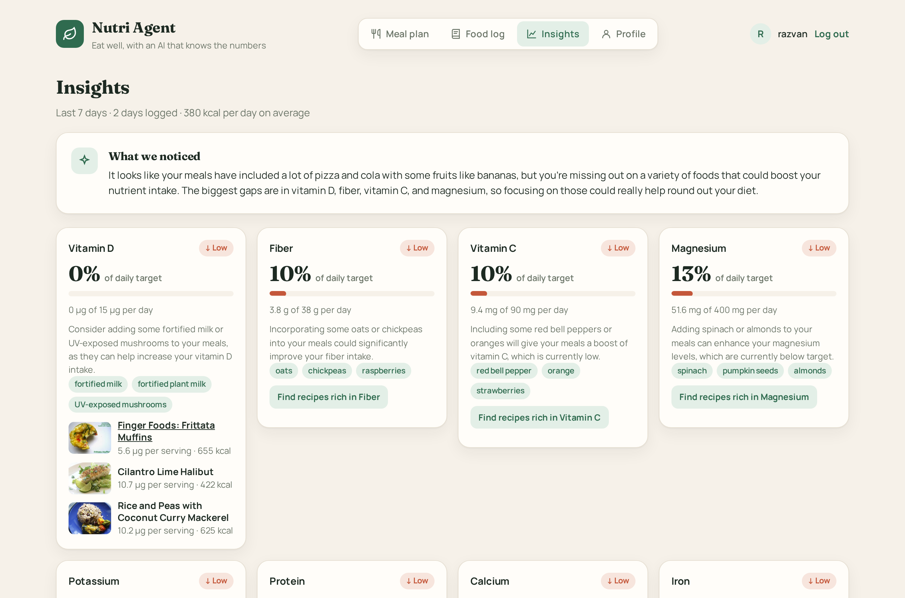

---

## Contents

- [Features](#features)
- [Screenshots](#screenshots)
- [How it works](#how-it-works)
  - [Architecture](#architecture)
  - [Design principle: AI for language, code for numbers](#design-principle-ai-for-language-code-for-numbers)
  - [Food log pipeline](#food-log-pipeline)
  - [Insights](#insights-1)
  - [Meal plan agent](#meal-plan-agent)
  - [Calorie and nutrient targets](#calorie-and-nutrient-targets)
  - [Guardrails](#guardrails)
- [Accounts and JWT login](#accounts-and-jwt-login)
- [Data model](#data-model)
- [HTTP API](#http-api)
- [Project structure](#project-structure)
- [Getting started](#getting-started)
- [Configuration](#configuration)
- [Tests](#tests)
- [Costs and limits](#costs-and-limits)
- [Known limitations](#known-limitations)
- [Credits and sources](#credits-and-sources)

---

## Features

| Area | What you get |
|---|---|
| **Accounts and onboarding** | Sign up, then a required profile step. Login uses a **JWT** in an HttpOnly cookie, and passwords are hashed with PBKDF2-SHA256 |
| **Profile** | Calories and macros (Mifflin-St Jeor), plus daily minimums for 8 nutrients from the NIH tables, recalculated whenever you edit the profile |
| **Food log** | Free-text entries per day, in any language. Each food shows the USDA match, grams and kcal; a day summary shows calories and 8 nutrient meters. Navigate between days, delete entries |
| **Insights** | 7-day averages for protein, fiber, vitamin C, vitamin D, calcium, iron, potassium and magnesium against your targets; an AI summary of your eating patterns; food suggestions from the NIH source lists; recipes rich in a missing nutrient |
| **Meal plan** | A tool-calling agent picks breakfast, lunch, dinner and a snack from Spoonacular, respecting diet and allergies; you can ask for changes ("swap dinner for fish") |
| **Transparency** | Every number links to a source (USDA, NIH, Spoonacular); foods without a trustworthy USDA match are flagged and not counted; the agent's tool calls are listed |
| **UI** | Light and dark mode, responsive down to phone width, keyboard focus states, labelled controls, status shown with text and icons, not only color |

## Screenshots

| Food log (real USDA lookups) | Insights |
|---|---|
| 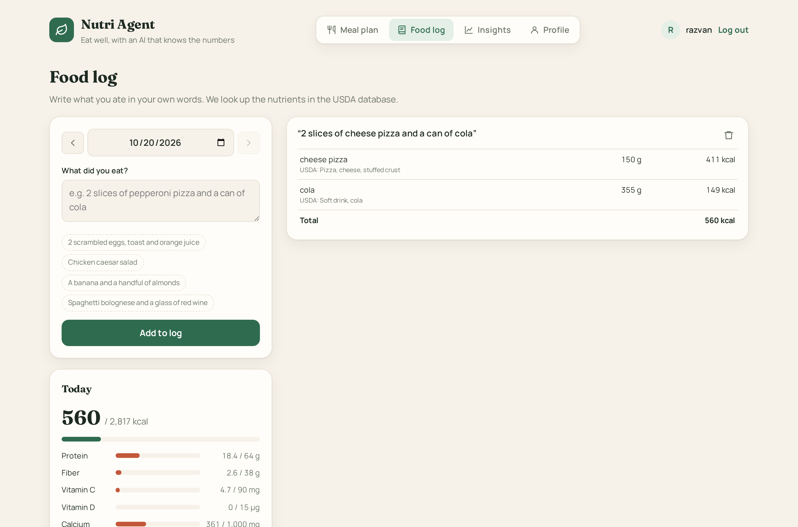 |  |

| Analyzing a meal | A gap with tips and recipes |
|---|---|
| 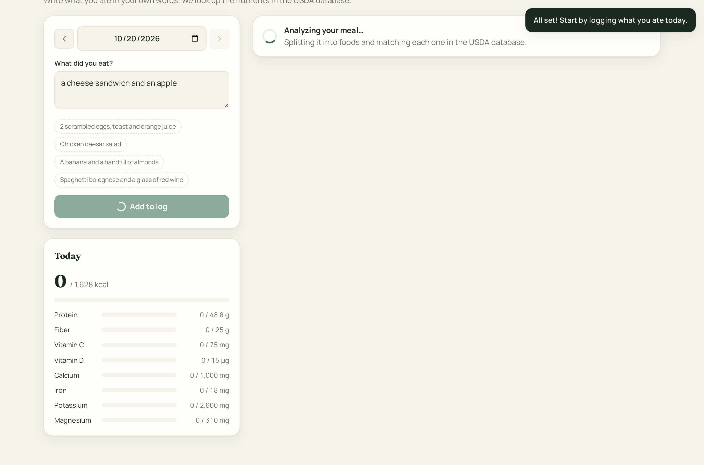 | 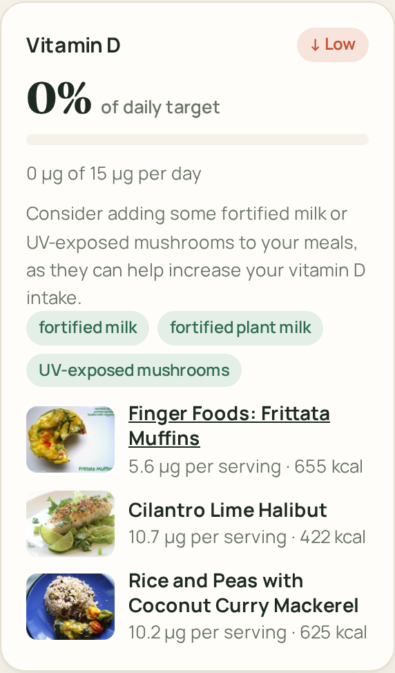 |

| Onboarding after sign-up | Profile and daily targets |
|---|---|
| 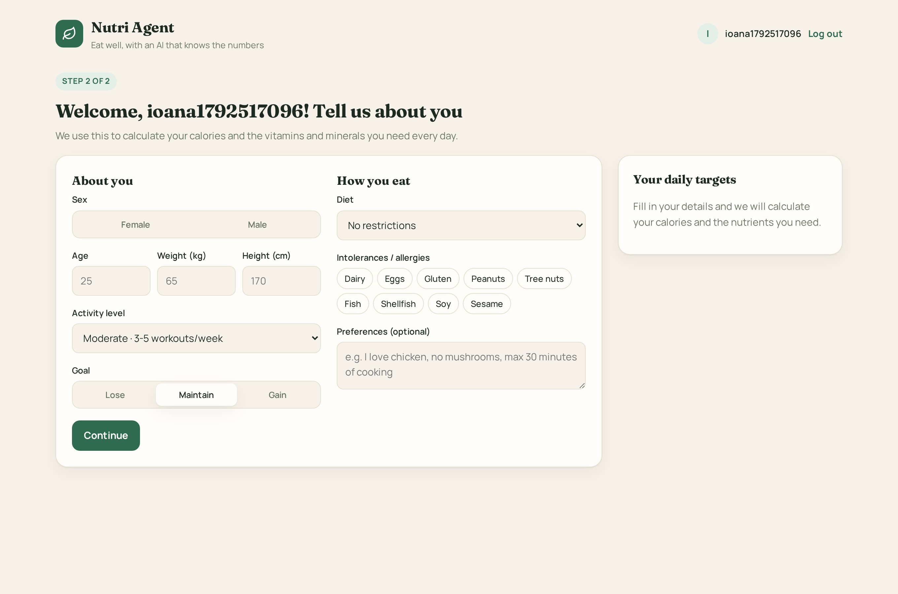 | 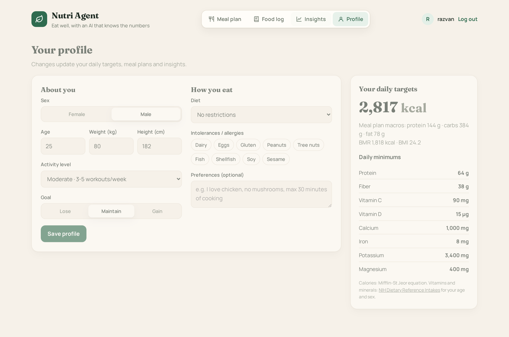 |

| Meal plan | Insights in dark mode |
|---|---|
|  | 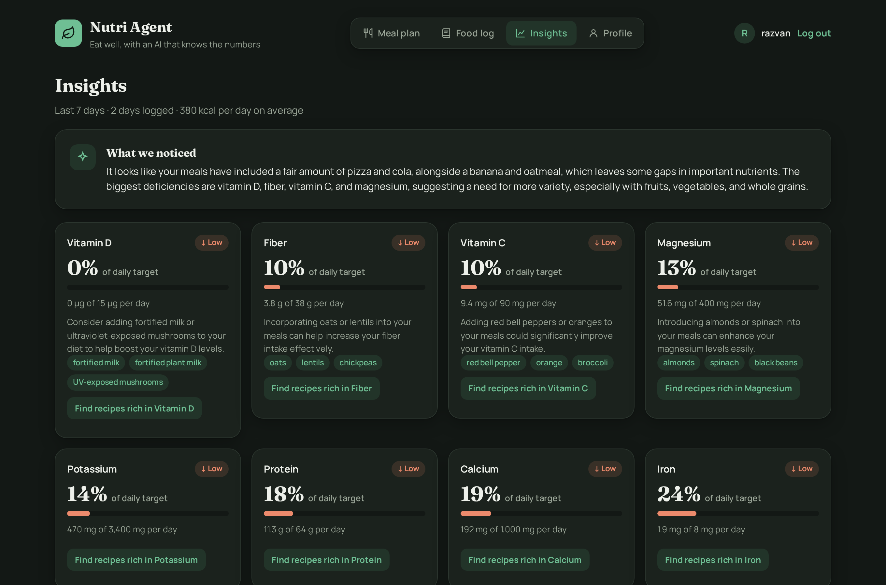 |

| Log in | Create an account |
|---|---|
| 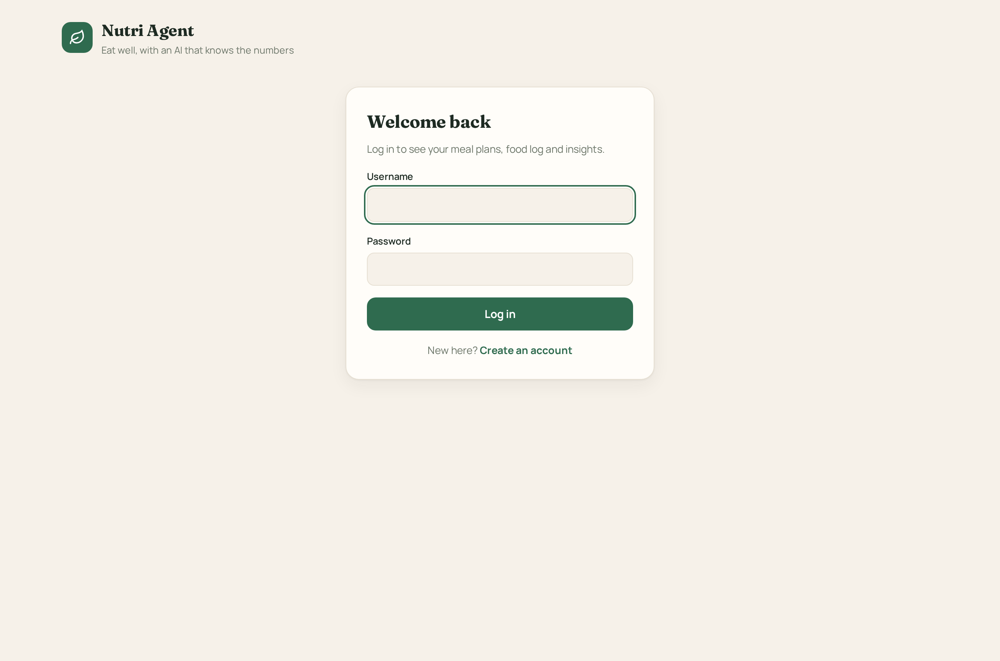 | 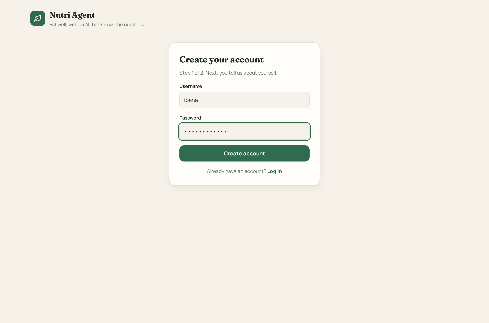 |

| Mobile: food log | Mobile: insights | Mobile: log in |
|---|---|---|
| 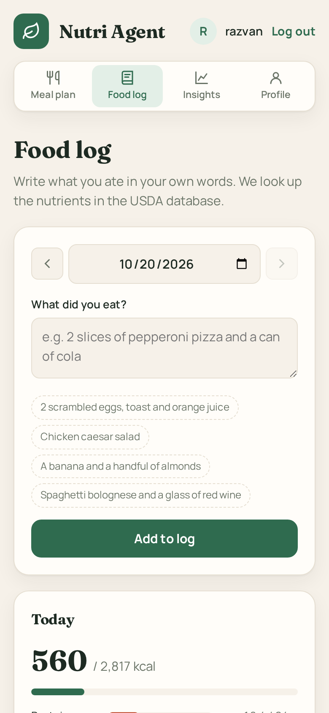 | 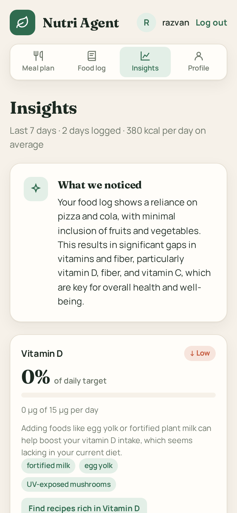 | 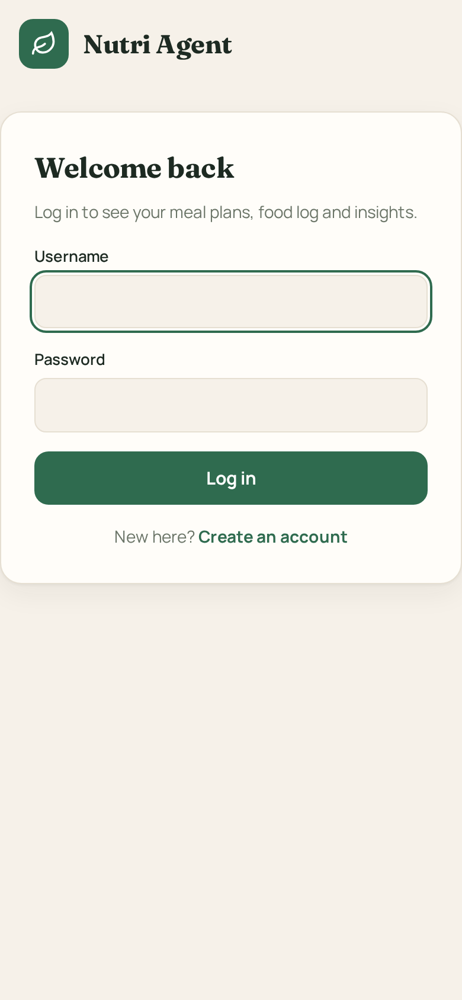 |

Except for the *Analyzing a meal* screenshot, these are real runs: the food log entries went through OpenAI and USDA, and the summaries, food tips, recipes and meal plan are real output from `gpt-4o-mini`, NIH data and Spoonacular. The *Analyzing* shot freezes the loading state on purpose.

---

## How it works

### Architecture

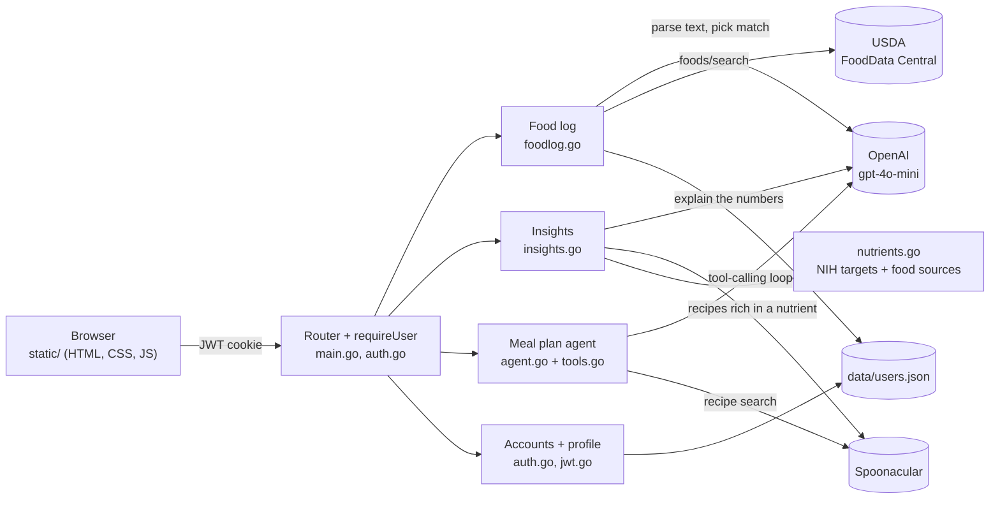

### Design principle: AI for language, code for numbers

Language models are good at understanding messy text and writing friendly explanations. They are unreliable at arithmetic and they invent facts. So every feature splits the work the same way:

| The AI does | The code does |
|---|---|
| Understands "2 slices of pizza and a coke" | Looks up nutrients in USDA and scales them to the grams eaten |
| Picks which USDA food matches, **from a closed list** | Rejects any choice outside that list |
| Explains the gaps in plain words | Computes averages, targets and percentages, and decides which gaps matter |
| Suggests foods, **only from the NIH source lists** | Drops any food not on those lists |
| Chooses recipes for a meal plan, **by ID** | Attaches the real recipe data and drops invented IDs |

Every AI answer has a strict JSON schema (OpenAI *Structured Outputs*), so the code always gets the same shape back.

### Food log pipeline

[`foodlog.go`](foodlog.go), `analyzeMeal`:

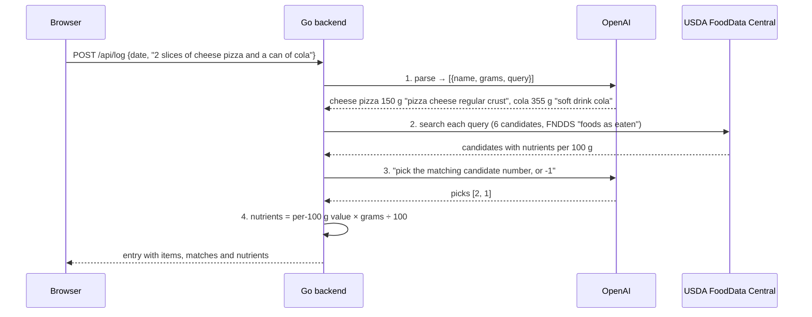

1. **Parse.** The model turns free text, in any language, into foods with an estimated weight and a search query worded the way USDA names foods.
2. **Search.** The code asks USDA for 6 candidates per food from the *FNDDS* dataset ("Food and Nutrient Database for Dietary Studies", foods as people actually eat them).
3. **Pick.** The model chooses the right candidate by number. This step exists because USDA's own ranking is unreliable: for `cola`, its first result is *"Whiskey and cola"*. If nothing fits, the model answers `-1`, and the food is shown as **"No USDA match, not counted"** instead of being guessed.
4. **Scale.** The code multiplies the per-100 g values by the grams eaten. The model never writes a nutrient number.

USDA results are cached per query in memory, so a food you log twice costs no extra lookup.

### Insights

[`insights.go`](insights.go). Two endpoints, so the page is fast:

1. `GET /api/insights` returns **the numbers, instantly, computed in code**:
   - takes the log entries of the last 7 days;
   - averages each nutrient **over the days you logged** (a day you forgot to log is not a day you ate nothing);
   - compares the averages with your daily targets → a percentage per nutrient;
   - lists the foods you ate, most frequent first.
2. `GET /api/insights/advice` returns **the explanation, a few seconds later**:
   - the code picks the gaps: nutrients below **80%** of target, at most **4**, lowest first;
   - the model receives your diet, intolerances, the foods you ate, and the percentage and NIH food sources for each nutrient;
   - it writes a 2–3 sentence summary of your patterns and one tip per gap, with 3 foods from the NIH list that fit your diet;
   - the code then **drops tips for nutrients that aren't gaps and foods that aren't on the NIH lists**.
3. `GET /api/recipes?nutrient=vitamin_c` searches Spoonacular for recipes where **one serving covers at least 25%** of your daily target (`minVitaminC`, `minIron`, …), filtered by your diet and intolerances.

On the page, a nutrient is **On track** at ≥ 80%, **Below target** at 50–79% and **Low** under 50%. Each status has a label and an icon, not only a color.

### Meal plan agent

[`agent.go`](agent.go) and [`tools.go`](tools.go). This is a **tool-calling loop**: the model decides which tool to call, the Go code runs it, the result goes back to the model, and this repeats until the model answers.

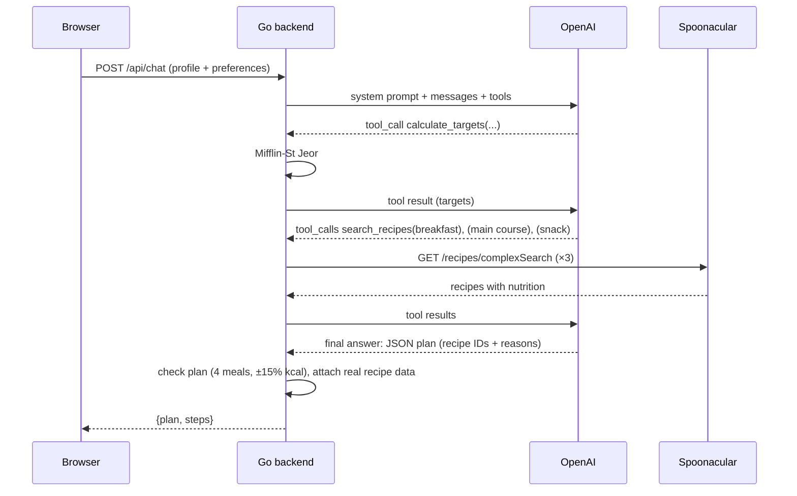

**Tools the model can call:**

| Tool | What it does | Parameters |
|---|---|---|
| `calculate_targets` | BMI, BMR, daily calories, protein, carbs, fat | `sex`, `age`, `weight_kg`, `height_cm`, `activity`, `goal` |
| `search_recipes` | Spoonacular `complexSearch` with nutrition included | **`diet`** and **`intolerances`** (required, so allergies are never forgotten), `query`, `type`, `exclude_ingredients`, `min_calories`, `max_calories`, `min_protein`, `number` (1–5) |

**Prompt rules:** call `calculate_targets` first and never do calorie math; make 3 searches (breakfast ~25%, one search shared by lunch and dinner ~32% each, snack ~11%), each with a ±20% calorie window; pass diet and all intolerances every time; return exactly 4 meals within ±10% of the target; for follow-ups, change only what was asked.

**The final plan** follows a strict schema `{message, targets, meals: [{recipe_id, meal, why}]}`. The model only picks **IDs**. `finalPlan` attaches the real title, photo, link and nutrition from the search results and **drops any ID the model invented**. `reviewPlan` asks for one correction if the plan has fewer than 4 meals or is more than 15% off the calorie target.

### Calorie and nutrient targets

**Calories and macros** (`calcTargets` in [`tools.go`](tools.go)):

| Quantity | Formula |
|---|---|
| BMR (men / women) | `10 × kg + 6.25 × cm − 5 × age + 5` / `… − 161` (Mifflin-St Jeor) |
| TDEE | `BMR × activity factor` (1.2 / 1.375 / 1.55 / 1.725 / 1.9) |
| Calories | `TDEE − 500` to lose, `TDEE` to maintain, `TDEE + 300` to gain; never below 1200 (women) or 1500 (men) |
| Macros for meal plans | protein `1.8 g × kg`, fat 25% of calories, carbs the rest |

**Daily nutrient targets** ([`nutrients.go`](nutrients.go)), from the NIH Office of Dietary Supplements, by age group and sex:

| Nutrient | Unit | Men 19–50 | Women 19–50 | Notes |
|---|---|---|---|---|
| Protein | g | 0.8 × kg | 0.8 × kg | RDA minimum, not the higher meal-plan target |
| Fiber | g | 38 | 25 | 30 / 21 after 50 |
| Vitamin C | mg | 90 | 75 | 75 / 65 for ages 14–18 |
| Vitamin D | µg | 15 | 15 | 20 after 70 |
| Calcium | mg | 1000 | 1000 | 1300 for 14–18; women 1200 after 50 |
| Iron | mg | 8 | 18 | women 8 after 50 |
| Potassium | mg | 3400 | 2600 | AI values |
| Magnesium | mg | 400–420 | 310–320 | lower value for ages 19–30 |

The full table, including teens and 71+, is the `dri` map in [`nutrients.go`](nutrients.go). Each nutrient also lists its USDA nutrient number, its Spoonacular filter and its main food sources from the NIH fact sheet.

### Guardrails

| Risk | What the code does |
|---|---|
| AI gets the math wrong | Calories, nutrients, averages and percentages are all computed in Go |
| AI invents a food match | It can only pick a candidate number from the USDA results; `-1` means "no match", shown to the user and not counted |
| AI invents recipes or images | Only recipe IDs returned by a real search are kept; titles, photos and nutrition come from Spoonacular |
| AI suggests unsafe or random foods | Tips are limited to the NIH source lists, filtered by diet and intolerances, and checked in code |
| AI explains a gap that isn't one | The code decides which nutrients are gaps; other tips are dropped |
| Allergies forgotten in meal plans | `diet` and `intolerances` are required tool parameters, and recipe searches for gaps use the saved profile directly |
| Plan missing meals or far off target | One automatic correction round ("Check plan" in the UI) |
| Endless agent loop | At most 10 model calls and 6 Spoonacular searches per request; then `tool_choice: "none"` forces an answer |
| Burning API quotas | Caches for USDA queries and Spoonacular searches; readable errors when a quota or rate limit is reached |
| Strangers using your API keys | Everything except login and sign-up requires a valid JWT |
| Bad input | Size limits on every body; profile values must be realistic (age 14–100, weight 30–300 kg, height 120–230 cm); dates are validated; at most 30 entries per day and 15 foods per entry |
| Data loss | `data/users.json` is written atomically (temp file + rename) and in-memory changes roll back if the write fails |
| HTML injection | The UI escapes every value and only allows `http(s)` links |
| Secrets in git | `.env` and `data/` are in `.gitignore` |

---

## Accounts and JWT login

Built with the Go standard library in [`auth.go`](auth.go) and [`jwt.go`](jwt.go).

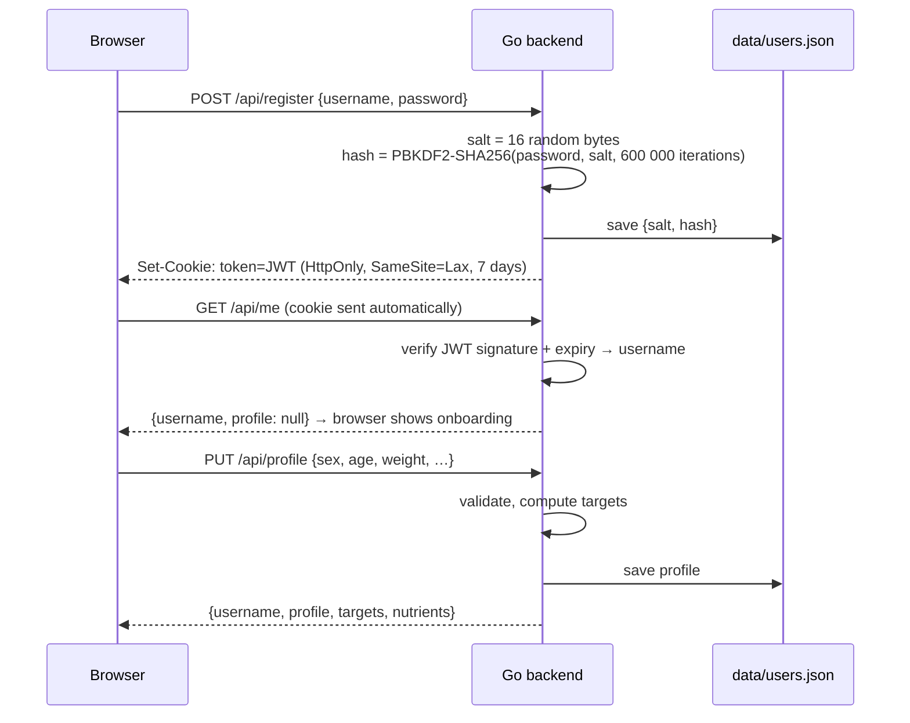

- **Onboarding:** while `profile` is `null`, the browser shows only the profile form ("Step 2 of 2"). Every other view needs a profile, and the server also refuses insights and nutrient recipes without one.
- **Passwords** are never stored, only a random 16-byte salt and a PBKDF2-SHA256 hash (600,000 iterations, OWASP's recommendation). Hashes are compared in constant time.
- **The JWT** has three base64url parts: `{"alg":"HS256","typ":"JWT"}` . `{"sub":"maria","exp":1761500000}` . `HMAC-SHA256(header.payload, JWT_SECRET)`.
  - `signToken` builds it.
  - `verifyToken` checks that the header is exactly our HS256 header (rejecting `"alg": "none"` tricks), recomputes the signature, compares it in constant time and checks `exp`.
- **Cookie:** `HttpOnly`, so page scripts can't read it; `SameSite=Lax`, so other sites can't send it with their POSTs.
- **Stateless:** there is no session table. `requireUser` wraps every protected route, verifies the token and checks that the user still exists.

## Data model

Everything is stored in one JSON file, `data/users.json` (permissions `0600`):

```json
{
  "razvan": {
    "salt": "9f1c…", "hash": "4be0…",
    "profile": { "sex": "male", "age": 25, "weight": 80, "height": 182, "activity": "moderate",
                 "goal": "maintain", "diet": "", "intolerances": [], "notes": "" },
    "log": {
      "2026-10-20": [
        { "id": "70b2435b9931fc8d", "text": "2 slices of cheese pizza and a can of cola",
          "items": [
            { "name": "cheese pizza", "grams": 150, "match": "Pizza, cheese, stuffed crust",
              "nutrients": { "kcal": 411, "protein": 18.35, "fiber": 2.55, "vitamin_c": 4.65, "calcium": 357, "…": 0 } },
            { "name": "cola", "grams": 355, "match": "Soft drink, cola", "nutrients": { "kcal": 149.1, "…": 0 } }
          ] }
      ]
    }
  }
}
```

Nutrients are stored already scaled to the portion, so insights are simple sums. One file is enough at class-project scale (see [Known limitations](#known-limitations)).

---

## HTTP API

All bodies are JSON. Errors are plain text with a readable message, which the UI shows as is.

| Method | Path | Auth | Body | Success | Errors |
|---|---|---|---|---|---|
| `POST` | `/api/register` | – | `{username, password}` | account + JWT cookie | `400` invalid, `409` taken |
| `POST` | `/api/login` | – | `{username, password}` | account + JWT cookie | `401` |
| `POST` | `/api/logout` | – | – | `204`, cookie deleted | – |
| `GET` | `/api/me` | JWT | – | account | `401` |
| `PUT` | `/api/profile` | JWT | profile | account with new targets | `400` unrealistic values |
| `GET` | `/api/log?date=YYYY-MM-DD` | JWT | – | `{date, entries}` | `400` bad date |
| `POST` | `/api/log` | JWT | `{date, text}` | the new entry | `400`, `502` AI/USDA failure |
| `DELETE` | `/api/log/{date}/{id}` | JWT | – | `204` | `404` |
| `GET` | `/api/insights` | JWT | – | `{from, to, days, kcal, nutrients, foods}` | `400` no profile |
| `GET` | `/api/insights/advice` | JWT | – | `{summary, tips: [{nutrient, advice, foods}]}` | `502` |
| `GET` | `/api/recipes?nutrient=key` | JWT | – | `{nutrient, recipes: [recipe + amount]}` | `400`, `502` |
| `POST` | `/api/chat` | JWT | `{messages: [{role, content}]}` | `{plan, steps}` | `400`, `502` |

**Account** (returned by register, login, `/api/me` and profile save):

```json
{ "username": "razvan",
  "profile": { "sex": "male", "age": 25, "weight": 80, "height": 182, "activity": "moderate", "goal": "maintain",
               "diet": "", "intolerances": [], "notes": "" },
  "targets": { "bmi": 24.2, "bmr": 1818, "tdee": 2817, "calories": 2817, "protein_g": 144, "carbs_g": 384, "fat_g": 78 },
  "nutrients": [ { "key": "vitamin_c", "label": "Vitamin C", "unit": "mg", "target": 90, "amount": 0, "percent": 0 }, "…" ] }
```

**Insights** (`GET /api/insights`): each item in `nutrients` has `amount` (average per logged day), `target` and `percent`.

**Meal plan** (`POST /api/chat`): send the whole conversation; the server keeps no chat state. For a follow-up, append the previous plan as an `assistant` message and the request as a `user` message, which the UI does automatically. Only `user` and `assistant` roles are accepted.

---

## Project structure

```
ai-nutrition-agent/
├── main.go           HTTP server, routes, .env loader, chat request validation
├── auth.go           sign-up, login, logout, profile, account response, users file
├── jwt.go            JWT (HS256) signing and verification
├── nutrients.go      the 8 tracked nutrients: NIH targets, food sources, USDA and Spoonacular ids
├── foodlog.go        food log: parse → USDA search → pick → scale; log endpoints
├── insights.go       7-day averages, AI advice with checks, recipes rich in a nutrient
├── agent.go          meal plan agent loop, OpenAI calls, structured outputs, plan check
├── tools.go          agent tools: calorie formula and Spoonacular recipe search
├── *_test.go         tests (no API keys needed)
├── static/
│   ├── index.html    page structure: header, login, the four views
│   ├── style.css     design tokens (light/dark), layout, components
│   └── app.js        API calls, routing (#plan #log #insights #profile), rendering
├── docs/images/      screenshots used in this README
├── data/users.json   created at runtime: accounts, profiles, food logs (git-ignored)
├── .env.example      template for your keys
└── go.mod            Go module, no dependencies
```

The `static/` folder is embedded in the Go binary with `//go:embed`, so the compiled program is a single file.

---

## Getting started

### 1. Requirements

- **Go 1.24 or newer** ([install](https://go.dev/doc/install)); `crypto/pbkdf2` joined the standard library in 1.24
- An **OpenAI API key** with credits ([platform.openai.com](https://platform.openai.com/api-keys))
- A free **Spoonacular API key** ([spoonacular.com/food-api/console](https://spoonacular.com/food-api/console#Dashboard))
- A free **USDA FoodData Central API key** ([fdc.nal.usda.gov/api-key-signup](https://fdc.nal.usda.gov/api-key-signup)), sent by email instantly. Without it the app uses `DEMO_KEY`, which allows only a handful of food lookups per hour

### 2. Configure

```bash
git clone https://github.com/tonyc973/ai-nutrition-agent.git
cd ai-nutrition-agent
cp .env.example .env
# edit .env: paste the API keys and set JWT_SECRET (openssl rand -hex 32)
```

### 3. Run

```bash
go run .
```

Open **http://localhost:8090**, create an account, fill in your profile and log your first meal.

To build a single binary instead: `go build -o nutri-agent . && ./nutri-agent`

> **Developing over SSH (e.g. VS Code Remote)?** The server runs on the remote machine, so `localhost:8090` in your local browser won't reach it. Forward the port: in VS Code, open the **Ports** panel and choose **Forward a Port → 8090**, or run `ssh -L 8090:localhost:8090 user@host`.

## Configuration

Set these in `.env` or as environment variables (real environment variables win).

| Variable | Required | Default | Description |
|---|---|---|---|
| `OPENAI_API_KEY` | yes | | OpenAI key |
| `SPOONACULAR_API_KEY` | yes | | Spoonacular key (meal plans, nutrient recipes) |
| `JWT_SECRET` | yes | | Signs login tokens; at least 32 characters. Changing it logs everyone out |
| `USDA_API_KEY` | recommended | `DEMO_KEY` | USDA FoodData Central key (food log) |
| `OPENAI_MODEL` | no | `gpt-4o-mini` | Any Chat Completions model with tools and structured outputs |
| `PORT` | no | `8090` | HTTP port |

The server refuses to start without the required variables, and warns at startup if `USDA_API_KEY` is missing.

## Tests

```bash
go test ./...          # add -race to also check for data races
```

The tests use local fake servers (`httptest`) instead of OpenAI, USDA and Spoonacular, so they need **no keys and cost nothing**.

| Test | What it checks |
|---|---|
| `TestCalcTargets` | Calorie formula for a known case, the 1200 kcal floor, rejection of unrealistic input |
| `TestDailyTarget` | NIH targets by age group and sex (e.g. iron 18 mg for a woman of 25, 8 mg at 60; calcium 1300 mg for a teen; vitamin D 20 µg after 70); protein 0.8 g/kg |
| `TestComputeInsights` | 7-day window boundaries, averaging over logged days only, percent of target, foods ordered by frequency |
| `TestFoodLogAPI` | Full food log over HTTP: auth required, profile required for insights, invalid date and empty text rejected, grams scaling (`40 kcal/100 g × 330 g = 132 kcal`), unmatched food has no nutrients, insights and advice; advice drops unknown nutrients and non-NIH foods; delete and double delete |
| `TestUSDARateLimit` | A USDA `429` becomes a readable message |
| `TestRunAgent` | Meal plan loop: tool call, tool result sent back, invented recipe ID dropped, one correction round |
| `TestSearchCap` | The 7th search never reaches Spoonacular and the model is forced to answer |
| `TestAuthFlow` | Sign-up, login, logout, wrong password, duplicate username, unrealistic profile rejected, profile persisted to disk, only a hash stored |
| `TestJWT` | Valid token accepted; changed payload, `alg: none`, garbage, expired token and wrong secret all rejected |

---

## Costs and limits

| Service | Free tier | Typical use |
|---|---|---|
| **OpenAI** `gpt-4o-mini` | pay per use | ~2 calls per food log entry, 1 per insights summary, 4–8 per meal plan; fractions of a cent each |
| **USDA FoodData Central** | 1,000 requests/hour with your own key; only a few with `DEMO_KEY` | 1 request per new food (cached afterwards) |
| **Spoonacular** | 50 points/day, reset daily | meal plan 5–12 points, nutrient recipes ~2 points; identical searches are cached |

**Latency:** a food log entry takes about 3–5 s, the insights numbers are instant and the AI summary takes about 3 s. A meal plan takes 6–20 s.

## Known limitations

- **Not medical advice.** Targets are general references for healthy people aged 14 and up. They don't cover pregnancy, breastfeeding, medical conditions or supplements.
- **Portions are estimates.** People rarely weigh food, so the AI assumes typical portions. That's why insights look at averages over several days rather than single meals.
- **Only foods with a USDA match count.** Unmatched foods are shown, not guessed.
- **One JSON file for all data.** It is written atomically and is fine at class-project scale, but every save rewrites the whole file. For real traffic, move to SQLite or PostgreSQL. We kept the file because the project otherwise has zero dependencies.
- **In-memory caches** (USDA queries, Spoonacular searches) grow until restart; a long-running deployment would use an LRU cache.
- **Server time zone.** The 7-day insights window uses the server's date, while the food log uses the browser's date. This can be off by a day across time zones.
- **Logout is client-side.** A copied JWT stays valid until it expires (7 days). Real revocation needs a token blocklist or short-lived tokens with refresh tokens.
- **No rate limiting on login, no HTTPS.** A public deployment needs both, and HTTPS lets the cookie be marked `Secure`.
- **Meal plans aren't saved.** They live in the browser tab.

## Credits and sources

- **Nutrient data:** U.S. Department of Agriculture, Agricultural Research Service. [FoodData Central](https://fdc.nal.usda.gov/), Food and Nutrient Database for Dietary Studies (FNDDS).
- **Daily targets and food sources:** [NIH Office of Dietary Supplements](https://ods.od.nih.gov/factsheets/list-all/), Dietary Reference Intakes and nutrient fact sheets.
- **Recipes, photos and recipe nutrition:** [Spoonacular Food API](https://spoonacular.com/food-api). Photos belong to the original recipe authors.
- **Calorie formula:** Mifflin MD, St Jeor ST et al., *A new predictive equation for resting energy expenditure in healthy individuals*, Am J Clin Nutr, 1990.
- **Language model:** [OpenAI](https://platform.openai.com/) `gpt-4o-mini`.
- **Fonts:** [Fraunces](https://fonts.google.com/specimen/Fraunces) and [Manrope](https://fonts.google.com/specimen/Manrope) via Google Fonts.
