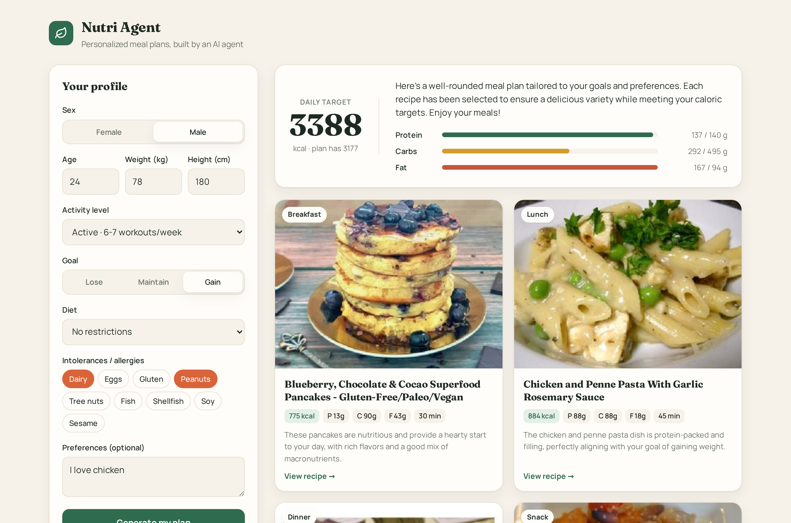
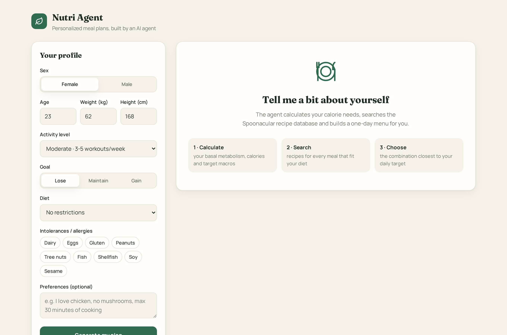
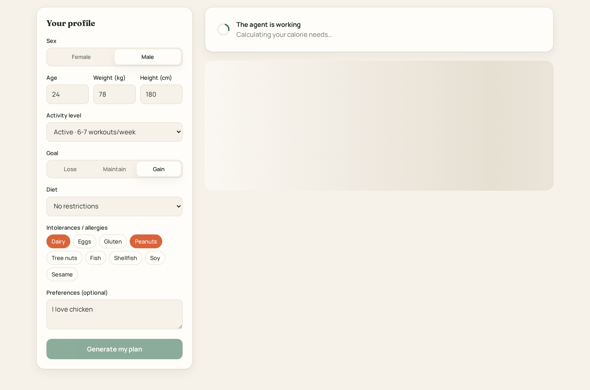
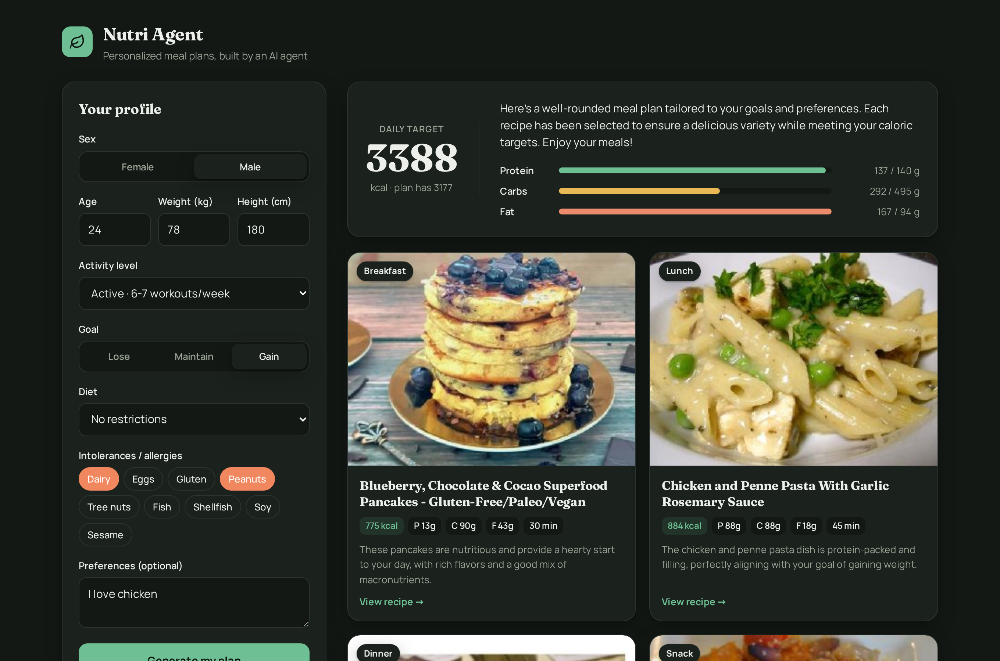
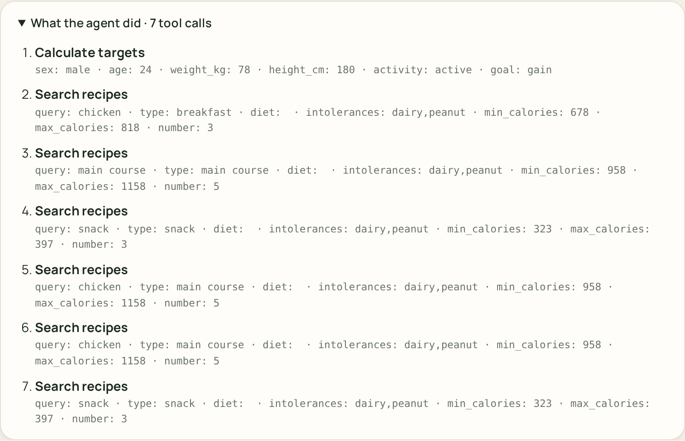
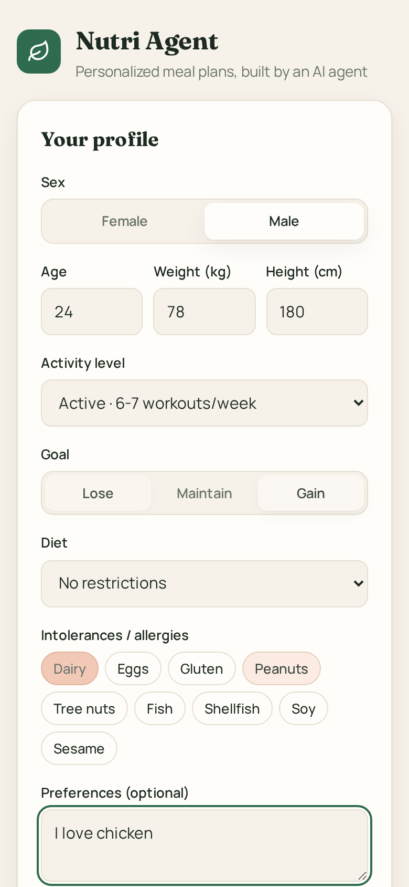
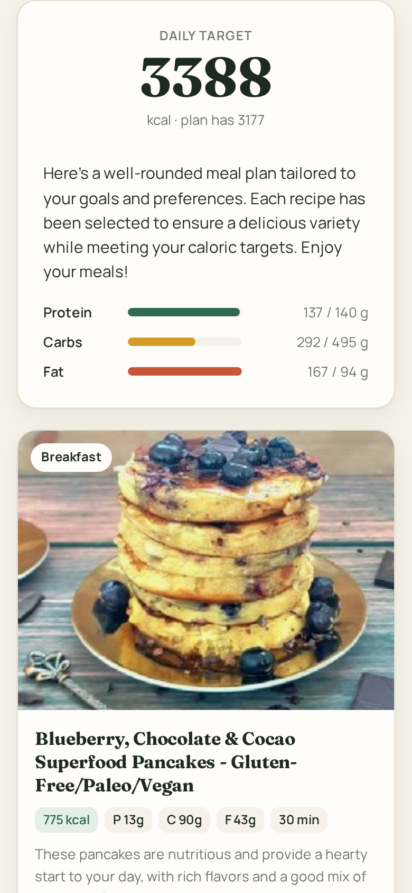
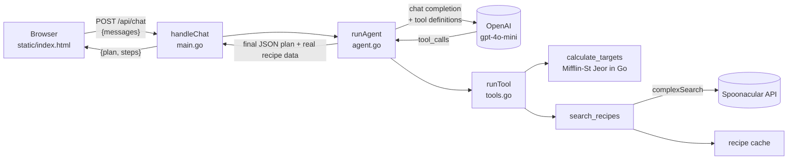
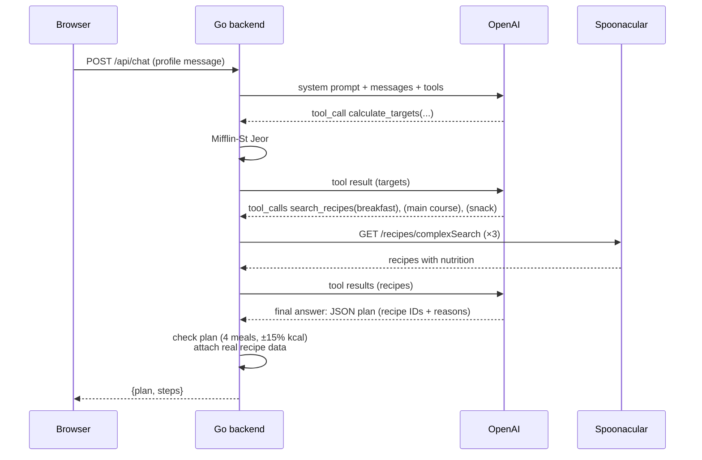

# Nutri Agent

An AI agent that turns a few details about you (age, weight, height, activity, goal, diet, allergies) into a **one-day meal plan made of real recipes**. It calculates your calorie and macro targets with a proper formula, searches the [Spoonacular](https://spoonacular.com/food-api) recipe database, and picks the combination of meals closest to your daily target.

The backend is written in **Go with zero external dependencies**. The "brain" is an OpenAI model (`gpt-4o-mini` by default) running a **tool-calling loop**: the model decides which tool to call, the Go code runs it, the result goes back to the model, and this repeats until the plan is ready.



---

## Contents

- [Features](#features)
- [Screenshots](#screenshots)
- [How it works](#how-it-works)
  - [Architecture](#architecture)
  - [The agent loop](#the-agent-loop)
  - [Tools](#tools)
  - [Calorie and macro formula](#calorie-and-macro-formula)
  - [The final plan](#the-final-plan)
  - [Guardrails](#guardrails)
- [HTTP API](#http-api)
- [Project structure](#project-structure)
- [Getting started](#getting-started)
- [Configuration](#configuration)
- [Tests](#tests)
- [Costs and limits](#costs-and-limits)
- [Known limitations](#known-limitations)
- [Credits](#credits)

---

## Features

- **Personal targets:** BMI, basal metabolic rate, daily calories and protein/carbs/fat targets, computed in Go (Mifflin-St Jeor) rather than guessed by the LLM.
- **Real recipes:** every meal comes from Spoonacular, with its photo, calories, macros, cooking time and a link to the full recipe.
- **Diet and allergies:** vegetarian, vegan, pescetarian, ketogenic, gluten free and paleo diets. Intolerances (dairy, eggs, gluten, peanuts, tree nuts, fish, shellfish, soy, sesame) are sent with every search.
- **Free-text preferences**, for example "I love chicken, max 30 minutes of cooking".
- **Follow-up changes:** after the plan appears you can ask "swap dinner for something with fish", and the agent changes only that meal.
- **Transparent agent:** the "What the agent did" panel lists every tool call with its arguments.
- **No made-up recipes:** the model may only pick recipe IDs that a search actually returned. Titles, photos and nutrition always come from Spoonacular.
- **Self-check:** if the final plan is missing meals or is more than 15% off the calorie target, the code asks the agent for one correction.
- **Light and dark mode, responsive layout**, keyboard focus states and labelled form controls.

## Screenshots

| Start screen | Agent working |
|---|---|
|  |  |

| Generated plan (dark mode) | Tool calls made by the agent |
|---|---|
|  |  |

| Mobile: profile | Mobile: plan |
|---|---|
|  |  |

The plan in these screenshots is a real run: a 24-year-old man, 78 kg, 180 cm, active, gaining weight, allergic to dairy and peanuts, who likes chicken. The recipes, targets, agent text and tool calls are real output from Spoonacular and `gpt-4o-mini`.

---

## How it works

### Architecture



1. The browser turns the form into a plain-English message, for example *"My profile: sex=male, age=24, weight=78 kg … Make me a plan for one day."*, and sends it with the conversation so far.
2. `runAgent` adds a system prompt and runs the agent loop described below.
3. When the model stops calling tools, its answer is a JSON plan. Go swaps each `recipe_id` for the real recipe data and returns the plan together with the list of tool calls.
4. The browser renders the targets, macro bars, recipe cards and agent steps.

### The agent loop



The loop lives in [`agent.go`](agent.go) (`runAgent`) and is about 40 lines. Each step:

1. Send the full message history to OpenAI's Chat Completions API, with the tool definitions and a strict JSON schema for the final answer.
2. If the model asks for tools, run each one, append the results as `tool` messages, and go back to step 1.
3. If the model answers without tool calls, that answer is the plan.

The system prompt tells the model to:
- always call `calculate_targets` first and never do calorie math itself;
- make exactly 3 searches: breakfast (~25% of calories), one search shared by lunch and dinner (~32% each, 5 results) and a snack (~11%), each with a ±20% calorie window;
- pass the user's diet and **all** intolerances on every search;
- return exactly 4 meals (Breakfast, Lunch, Dinner, Snack) within ±10% of the target;
- on follow-up requests, change only what the user asked for.

### Tools

Defined in [`tools.go`](tools.go) as JSON Schema, which is what the model sees.

#### `calculate_targets`

| Parameter | Type | Values |
|---|---|---|
| `sex` | string | `male`, `female` |
| `age` | number | 14 to 100 |
| `weight_kg` | number | 30 to 300 |
| `height_cm` | number | 120 to 230 |
| `activity` | string | `sedentary`, `light`, `moderate`, `active`, `very_active` |
| `goal` | string | `lose`, `maintain`, `gain` |

Returns `{bmi, bmr, tdee, calories, protein_g, carbs_g, fat_g}`. Out-of-range values return an error that the model can explain to the user.

#### `search_recipes`

| Parameter | Type | Spoonacular parameter | Notes |
|---|---|---|---|
| `diet` | string, **required** | `diet` | `""` if none |
| `intolerances` | string, **required** | `intolerances` | comma separated, `""` if none |
| `query` | string | `query` | keywords, e.g. `chicken` |
| `type` | string | `type` | `breakfast`, `main course`, `snack`, … |
| `exclude_ingredients` | string | `excludeIngredients` | comma separated |
| `min_calories` / `max_calories` | number | `minCalories` / `maxCalories` | per serving |
| `min_protein` | number | `minProtein` | grams per serving |
| `number` | integer | `number` | clamped to 1–5, default 3 |

The call always adds `addRecipeNutrition=true`, so each result already includes calories and macros and no second request is needed. The API key is sent in the `x-api-key` header, never in the URL, so it can't leak into logs or error messages. The tool returns a compact list: `{id, title, image, url, ready_in_minutes, calories, protein_g, carbs_g, fat_g}`.

`diet` and `intolerances` are required on purpose. During testing, `gpt-4o-mini` sometimes forgot to send the user's allergies. Making the fields required forces the model to fill them in on every search.

### Calorie and macro formula

`calcTargets` in [`tools.go`](tools.go) is a plain, tested Go function:

| Quantity | Formula |
|---|---|
| BMR (men) | `10 × kg + 6.25 × cm − 5 × age + 5` |
| BMR (women) | `10 × kg + 6.25 × cm − 5 × age − 161` |
| TDEE | `BMR × activity factor` (1.2 / 1.375 / 1.55 / 1.725 / 1.9) |
| Calories | `TDEE − 500` to lose, `TDEE` to maintain, `TDEE + 300` to gain |
| Safety floor | never below 1200 kcal (women) or 1500 kcal (men) |
| Protein | `1.8 g × kg` |
| Fat | 25% of calories ÷ 9 |
| Carbs | the remaining calories ÷ 4 |
| BMI | `kg ÷ m²` |

Example: a 30-year-old man, 80 kg, 180 cm, moderately active, maintaining weight has a BMR of 1780 and a target of 2759 kcal, 144 g protein and BMI 24.7. This exact case is checked in the tests.

### The final plan

The final answer must match a **strict JSON schema** (OpenAI Structured Outputs), so the UI always gets the same shape:

```json
{
  "message": "2-3 sentences about the plan",
  "targets": { "calories": 3388, "protein_g": 140, "carbs_g": 495, "fat_g": 94 },
  "meals": [
    { "recipe_id": 637923, "meal": "Lunch", "why": "One sentence on why it fits" }
  ]
}
```

The model only chooses **IDs** and writes the explanations. `finalPlan` then looks each ID up in the recipe cache, which holds only recipes that really came back from Spoonacular. It attaches the real title, photo, link and nutrition, and **drops any ID the model invented**.

### Guardrails

| Risk | What the code does |
|---|---|
| The LLM gets calorie math wrong | Math is done in Go by `calculate_targets`; the prompt forbids the model from doing it |
| Made-up recipes or images | Only IDs returned by `search_recipes` are kept; recipe data comes from the cache, not the model |
| Allergies forgotten | `diet` and `intolerances` are required tool parameters, and the prompt says to send them on every search |
| Plan missing meals or far off target | `reviewPlan` sends the model one automatic correction request (4 meals, ±15% kcal), shown as "Check plan" in the UI |
| Endless loop | At most 10 model calls per request |
| Burning the Spoonacular quota | At most 6 searches per request; an identical search is served from an in-memory cache for free |
| Model keeps calling tools after the limit | Once searches or steps run out, the request is sent with `tool_choice: "none"`, which forces a final answer |
| Browser injecting a system prompt | `/api/chat` accepts only `user` and `assistant` roles and bodies up to 64 KB |
| HTML injection from recipe titles or model text | The UI escapes every value and only allows `http(s)` links |
| Secrets in git | Keys live in `.env`, which is in `.gitignore` |

---

## HTTP API

### `POST /api/chat`

Request: the whole conversation (the server keeps no session state).

```json
{
  "messages": [
    { "role": "user", "content": "My profile: sex=female, age=26, weight=64 kg, height=170 cm, activity=moderate, goal=lose. Diet: vegetarian. Intolerances: dairy. Preferences: none. Make me a plan for one day." }
  ]
}
```

For a follow-up, add the previous plan as an `assistant` message and the new request as a `user` message. The UI does this automatically.

Response `200`:

```json
{
  "plan": {
    "message": "Here's a well-rounded meal plan…",
    "targets": { "calories": 3388, "protein_g": 140, "carbs_g": 495, "fat_g": 94 },
    "meals": [
      {
        "recipe_id": 637923,
        "meal": "Lunch",
        "why": "The chicken and penne pasta dish is protein-packed and filling…",
        "recipe": {
          "id": 637923,
          "title": "Chicken and Penne Pasta With Garlic Rosemary Sauce",
          "image": "https://img.spoonacular.com/recipes/637923-312x231.jpg",
          "url": "https://www.foodista.com/recipe/DTDN76GH/chicken-and-penne-pasta-with-garlic-rosemary-sauce",
          "ready_in_minutes": 45,
          "calories": 884, "protein_g": 88, "carbs_g": 88, "fat_g": 18
        }
      }
    ]
  },
  "steps": [
    { "tool": "calculate_targets", "args": "{\"sex\":\"male\",\"age\":24,…}" },
    { "tool": "search_recipes", "args": "{\"type\":\"breakfast\",…}" }
  ]
}
```

Errors return a plain-text body:

| Status | When |
|---|---|
| `400` | invalid JSON, empty `messages`, or a role other than `user`/`assistant` |
| `502` | OpenAI or the agent failed, e.g. an invalid key, no credits, or the step limit was reached. The upstream message is included and shown in the UI |

---

## Project structure

```
ai-nutrition-agent/
├── main.go             HTTP server, .env loader, request validation
├── agent.go            agent loop, system prompt, plan schema, OpenAI call, plan check
├── tools.go            tool definitions, calorie formula, Spoonacular search, caches
├── agent_test.go       tests (no API keys needed)
├── static/
│   └── index.html      the whole UI: HTML + CSS + vanilla JS, embedded in the binary
├── docs/images/        screenshots used in this README
├── .env.example        template for your keys
└── go.mod              Go module, no dependencies
```

The UI is embedded in the Go binary with `//go:embed`, so the compiled program is a single file.

---

## Getting started

### 1. Requirements

- **Go 1.22 or newer** ([install](https://go.dev/doc/install))
- An **OpenAI API key** with credits ([platform.openai.com](https://platform.openai.com/api-keys))
- A free **Spoonacular API key** ([spoonacular.com/food-api/console](https://spoonacular.com/food-api/console#Dashboard))

### 2. Configure

```bash
git clone https://github.com/tonyc973/ai-nutrition-agent.git
cd ai-nutrition-agent
cp .env.example .env
# edit .env and paste both keys
```

### 3. Run

```bash
go run .
```

Open **http://localhost:8090**.

To build a single binary instead:

```bash
go build -o nutri-agent . && ./nutri-agent
```

> **Developing over SSH (e.g. VS Code Remote)?** The server runs on the remote machine, so `localhost:8090` in your local browser won't reach it. Forward the port: in VS Code, open the **Ports** panel and choose **Forward a Port → 8090**, or run `ssh -L 8090:localhost:8090 user@host`.

## Configuration

Set these in `.env` or as environment variables. Real environment variables take precedence over `.env`.

| Variable | Required | Default | Description |
|---|---|---|---|
| `OPENAI_API_KEY` | yes | | OpenAI key |
| `SPOONACULAR_API_KEY` | yes | | Spoonacular key |
| `OPENAI_MODEL` | no | `gpt-4o-mini` | Any Chat Completions model that supports tools and structured outputs |
| `PORT` | no | `8090` | HTTP port |

The server refuses to start if either key is missing.

## Tests

```bash
go test ./...
```

The tests use local fake servers (`httptest`) in place of OpenAI and Spoonacular, so they need **no keys and cost nothing**:

| Test | What it checks |
|---|---|
| `TestCalcTargets` | Formula values for a known man, the 1200 kcal floor for a small woman, rejection of unrealistic input |
| `TestRunAgent` | The full loop: the model calls a tool, the tool result goes back to the model, an invented recipe ID is dropped, and a bad plan gets exactly one correction round |
| `TestSearchCap` | The 7th search in one request never reaches Spoonacular, and the model is then forced to answer (`tool_choice: "none"`) |

---

## Costs and limits

- **Spoonacular free plan: 50 points per day.** A search costs about 1 point, plus 1 point when calorie or protein filters are used, plus a little per result. A full plan usually uses **5–12 points**, so expect roughly **4–8 plans per day** on the free tier. Repeated identical searches cost nothing thanks to the cache. The quota resets daily.
- **OpenAI:** a plan takes 4–8 model calls with `gpt-4o-mini`, which costs a fraction of a cent.
- **Latency:** about 6–20 seconds per plan, mostly waiting on the model.

## Known limitations

- **Not medical advice.** The formula estimates needs for healthy adults. It does not cover pregnancy, medical conditions or athletes with special needs.
- **Allergies are enforced through the model.** The prompt and required parameters make the model pass intolerances, and Spoonacular filters on them, but a production app should also enforce them in code and show warnings.
- **In-memory caches** grow with every search and reset when the server restarts. That's fine for a demo; a real deployment would use a database or an LRU cache.
- **No accounts or saved history.** The conversation lives in the browser tab.
- **Recipes are in English**, as returned by Spoonacular. Nutrition values are per serving, as Spoonacular reports them.
- **Macro balance:** the agent optimizes for total calories, so individual macros (e.g. fat) can land above or below target. The UI bars show this openly.

## Credits

- Recipes, photos and nutrition data: [Spoonacular Food API](https://spoonacular.com/food-api). Photos belong to the original recipe authors.
- Language model: [OpenAI](https://platform.openai.com/) `gpt-4o-mini`.
- Fonts: [Fraunces](https://fonts.google.com/specimen/Fraunces) and [Manrope](https://fonts.google.com/specimen/Manrope) via Google Fonts.
- BMR formula: Mifflin MD, St Jeor ST et al., *A new predictive equation for resting energy expenditure in healthy individuals*, Am J Clin Nutr, 1990.
